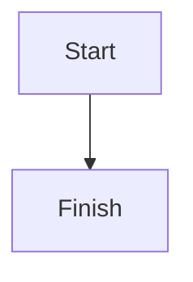

# Diagram Concept

A valid flowchart Diagram:



A malformed diagram that must degrade gracefully:

```mermaid
not a valid mermaid diagram !!!
```

A D2 Diagram, with an icon that must never be fetched:

```d2
direction: right
api: API gateway
db: Postgres { shape: cylinder }
api -> db: SQL
monitor: Monitor { icon: https://icons.terrastruct.com/essentials/087-display.svg }
monitor -> api: probes
```

A malformed D2 diagram:

```d2
a -> {
```

Body text after the diagrams so the page clearly stays intact.
